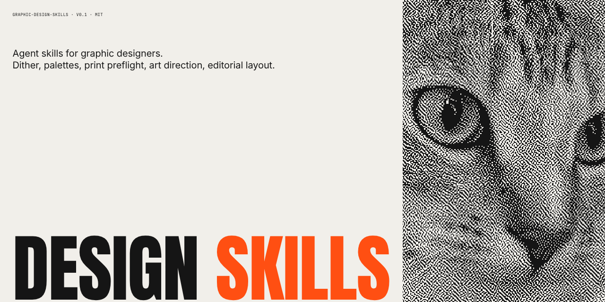

<p align="center"></p>

**Des skills d'agent pour graphistes.** Ils donnent à Claude (ou à tout agent qui lit les `SKILL.md`) de vrais outils de design : tramer une photo pour une impression riso, construire une palette et vérifier ses contrastes, contrôler un PDF avant que l'imprimeur le refuse, décortiquer la direction artistique d'un site, et mettre en page un PDF éditorial qui ne fait pas « généré par IA ».

Chaque skill est un dossier avec des instructions écrites du point de vue d'un graphiste, et des scripts testés qui font le travail sur les pixels et les PDF.

## Les skills

| Skill | Ce qu'il fait |
|---|---|
| [**dither**](skills/dither) | Photo → bitmap 1 bit, trame de demi-teinte, duotone ou couleur façon risographie. 14 méthodes (Floyd–Steinberg, Atkinson, Bayer, points de trame…), en PNG ou SVG, à la bonne taille pour l'écran ou l'impression. |
| [**palette**](skills/palette) | Extrait une palette d'une image, génère des gammes et harmonies en OKLCH, vérifie les contrastes WCAG, exporte en ASE (Adobe), Tailwind, CSS, design tokens, GPL. |
| [**print-preflight**](skills/print-preflight) | Contrôle un PDF avant impression : fond perdu, résolution réelle des images, polices incorporées, RVB/CMJN/tons directs, taux d'encrage, filets trop fins. Explique chaque correction dans InDesign, Illustrator, Affinity, Canva, Figma. |
| [**art-direction-analyzer**](skills/art-direction-analyzer) | Analyse la typo, les couleurs, la grille, le motion et les images d'un site à partir de la page affichée, et enregistre une fiche de référence avec captures. |
| [**editorial-layout**](skills/editorial-layout) | Mises en page éditoriales en HTML/CSS sur une grille d'impression de 12 colonnes, avec des règles contre l'effet « template IA ». Sort le PDF et des aperçus, et vérifie chevauchements, polices, résolution et fond perdu. |

## Installation

**Claude Code** :
```
/plugin marketplace add Remicht0/graphic-design-skills
/plugin install graphic-design-skills@graphic-design-skills
```

**N'importe quel agent** (via le [CLI skills](https://skills.sh)) :
```bash
npx skills add Remicht0/graphic-design-skills
```

**Appli Claude (web, desktop)** : télécharge le `.zip` d'un skill dans les [Releases](https://github.com/Remicht0/graphic-design-skills/releases), puis **Customize → Skills → + → Upload a skill** (libellés de l'interface en anglais). L'exécution de code doit être activée dans Settings → Capabilities.

## Contribuer

Les nouveaux skills sont les bienvenus, y compris de graphistes qui ne codent pas : un skill, c'est surtout un `SKILL.md` bien écrit. Lis [CONTRIBUTING.md](CONTRIBUTING.md) (en anglais) et pars de [`template/SKILL.md`](template/SKILL.md). Les issues et pull requests en français sont acceptées.

## Licence

[MIT](LICENSE). Photos d'exemple CC0 (scikit-image), polices sous licence SIL OFL (Fontsource).
