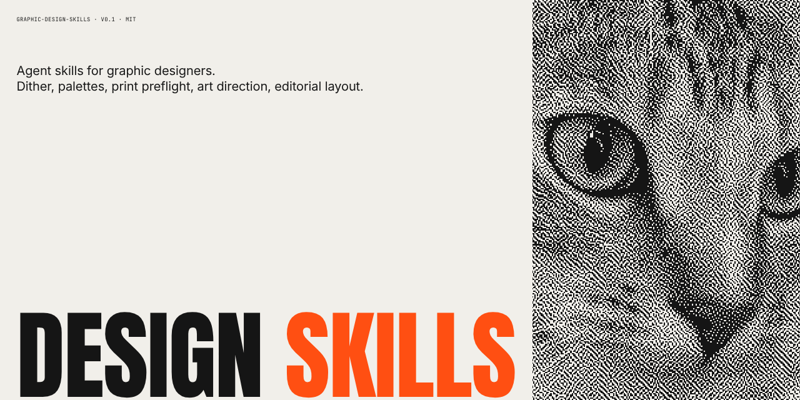
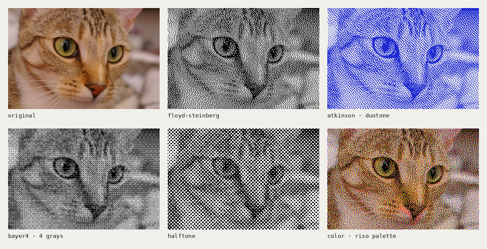
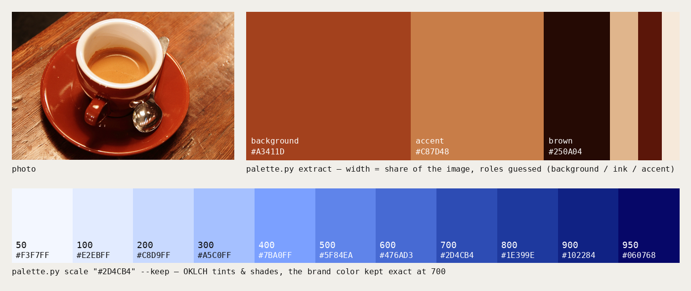
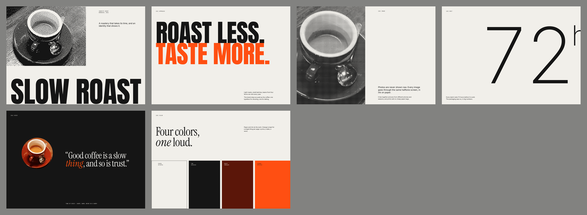

<p align="center"></p>

<p align="center">
  <a href="LICENSE"></a>
  
  
  <a href="README.fr.md"></a>
</p>

**Agent skills for graphic designers.** Give Claude (or any agent that reads `SKILL.md`) real design tools: dither a photo for a risograph print, build a palette and check its contrast, preflight a PDF before the print shop rejects it, break down a website's art direction, and lay out an editorial PDF that doesn't look generated.

Each skill is a folder with instructions written from a designer's point of view, plus tested scripts that do the pixel and PDF work.

## Skills

| Skill | What it does |
|---|---|
| [**dither**](skills/dither) | Photos to 1-bit, halftone, duotone or risograph-style color. 14 methods (Floyd–Steinberg, Atkinson, Bayer, halftone dots…), PNG or SVG, sized right for screen or print. |
| [**palette**](skills/palette) | Extract a palette from an image, generate OKLCH scales and harmonies, check WCAG contrast, export to ASE (Adobe), Tailwind, CSS, design tokens, GPL. |
| [**print-preflight**](skills/print-preflight) | Checks a PDF before printing: bleed, image ppi at placed size, embedded fonts, RGB/CMYK/spot, ink coverage, hairlines. Explains each fix for InDesign, Illustrator, Affinity, Canva, Figma. |
| [**art-direction-analyzer**](skills/art-direction-analyzer) | Breaks down a live website's typography, color, grid, motion and imagery from the rendered page, and saves a reference file with screenshots. |
| [**editorial-layout**](skills/editorial-layout) | Magazine-style PDFs in HTML/CSS on a 12-column print grid, with design rules against the "AI template" look. Renders PDF + previews, checks overlaps, fonts, image resolution, bleed. |

The skills work together: the layout example below uses images made with `dither`, colors from `palette`, and its PDF passes `print-preflight`.

## Install

**Claude Code** (plugin marketplace):
```
/plugin marketplace add Remicht0/graphic-design-skills
/plugin install graphic-design-skills@graphic-design-skills
```

**Any agent** (Claude Code, Codex, Cursor, OpenCode… via the [skills CLI](https://skills.sh)):
```bash
npx skills add Remicht0/graphic-design-skills
```

**Claude app (web, desktop)**: download a skill's `.zip` from [Releases](https://github.com/Remicht0/graphic-design-skills/releases) (or build them with `python3 scripts/package.py`), then go to **Customize → Skills → + → Upload a skill**. Code execution must be enabled in Settings → Capabilities.

**Manually**: copy a folder from `skills/` into `~/.claude/skills/` (or your agent's skills folder).

Python dependencies, installed on first use: `pillow numpy` (dither, palette), `pikepdf` (preflight), `playwright` (layout, website capture).

## Gallery

### dither


```bash
python3 scripts/dither.py photo.jpg -o poster.png -m atkinson --width 270 --scale 4 --palette "#1F2BD1,#F3F2EE"
```

### palette


### editorial-layout


An identity brief for a fictional coffee roaster, six A4 landscape pages, each with a different composition. Source: [`skills/editorial-layout/templates/example.html`](skills/editorial-layout/templates/example.html).

### print-preflight
```
**Not ready to print** · 2 fail · 5 warning · 0 pass · 1 page(s) · PDF 1.4 · target: print

- ❌ images — Image 150×100 px placed at 210×140 mm = 18 ppi (pixelated in print; needs 300 ppi, i.e. 2481 px wide).
- ❌ fonts — Font not embedded: Helvetica. The printer will substitute another font.
- ⚠️ bleed — No bleed: the page is exactly the finished size. Anything that touches the edge will show a white sliver after cutting.
- ⚠️ ink — CMYK colors up to 380% total ink (limit 300%): smearing / long drying. For rich black use about 60/40/40/100.
- ⚠️ strokes — 1 stroke(s) thinner than 0.25 pt: hairlines may disappear or break up in print.
```

## Contributing

New skills and improvements are very welcome, including from designers who don't code: a skill is mostly a well-written `SKILL.md`. Read [CONTRIBUTING.md](CONTRIBUTING.md), start from [`template/SKILL.md`](template/SKILL.md), and check the [list of wanted skills](CONTRIBUTING.md#skills-wed-love-to-have).

```bash
python3 scripts/validate.py      # format checks
python -m pytest -q              # script tests
```

## Credits

- Sample photos from [scikit-image](https://scikit-image.org) data, both CC0: *Chelsea the cat* by Stefan van der Walt, *coffee* by Rachel Michetti.
- Fonts in the examples (Anton, Inter, Instrument Serif, JetBrains Mono) are under the SIL Open Font License, fetched from [Fontsource](https://fontsource.org).
- "Slow Roast" is a fictional brand.

Made by [Remicht0](https://github.com/Remicht0), with Claude.

## License

[MIT](LICENSE)
